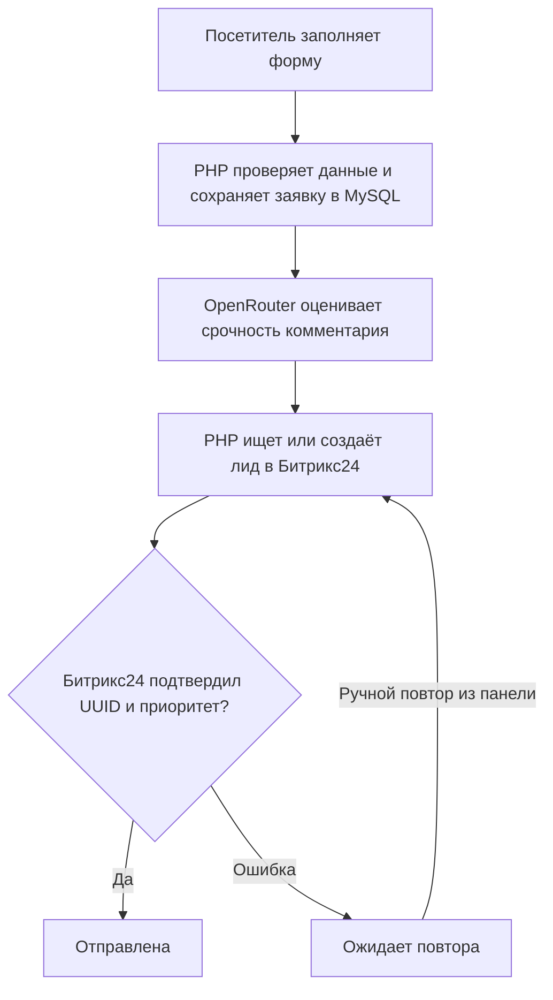

# Тестовое Спектр

Тестовое приложение для приёма заявок с сайта и создания лидов в Битрикс24. Посетитель оставляет контакты и комментарий. Оператор видит заявки в защищённой панели, фильтрует их по приоритету и статусу и при необходимости повторяет доставку.

[Как работает проект](#как-проходит-заявка) · [Локальный запуск](#локальный-запуск) · [Битрикс24](#битрикс24) · [Проверка и демонстрация](#проверка-и-демонстрация)

## Как проходит заявка



Сообщение **«Заявка принята»** подтверждает запись в MySQL. При недоступности AI обработка продолжается с обычным приоритетом. Статус **«Отправлена»** выставляется после проверки карточки в Битрикс24. История попыток показывает, когда запускалась доставка и чем она завершилась.

| Статус в базе | Что произошло |
| --- | --- |
| `saved` | Заявка сохранена, попытка ещё не началась. |
| `processing` | Процесс захватил заявку и выполняет попытку доставки. |
| `retry` | Доставка завершилась ошибкой, заявку можно повторить из панели. |
| `sent` | Битрикс24 вернул ожидаемые UUID и значение поля приоритета. |

## Структура проекта

| Файлы | Назначение |
| --- | --- |
| [`public/index.php`](public/index.php), [`public/assets/`](public/assets/) | HTTP-маршруты, JavaScript публичной формы, стили и изображение. |
| [`views/`](views/), [`src/admin.php`](src/admin.php) | PHP-шаблоны, вход в панель, сессия, CSRF, фильтры и ручной повтор. |
| [`src/submit.php`](src/submit.php), [`src/validation.php`](src/validation.php) | Приём JSON, проверка и нормализация полей. |
| [`src/Store.php`](src/Store.php), [`database/001_init.sql`](database/001_init.sql) | PDO, транзакции, таблицы заявок и попыток доставки, ограничение частоты запросов. |
| [`src/Delivery.php`](src/Delivery.php), [`src/integrations.php`](src/integrations.php) | Обработка доставки, HTTP-клиенты OpenRouter и Битрикс24. |
| [`scripts/`](scripts/), [`tests/acceptance.py`](tests/acceptance.py) | Миграция, проверка полей CRM, команды для демо и приёмочные тесты. |

## Локальный запуск

Нужны PHP 8.1+ с расширениями `pdo_mysql`, `curl`, `mbstring` и MySQL 8.0+. У приложения нет зависимостей Composer или npm. Все команды выполняются из корня проекта.

### 1 Подготовьте конфигурацию и MySQL

В новом клоне скопируйте `.env.example` в `.env`.

```powershell
Copy-Item .env.example .env
```

На Linux или macOS выполните `cp .env.example .env`. Запустите MySQL. Через Workbench или консоль MySQL от имени администратора базы создайте схему и отдельного пользователя. Замените `<DB_PASSWORD>` своим паролем.

```sql
CREATE DATABASE spektr CHARACTER SET utf8mb4 COLLATE utf8mb4_unicode_ci;
CREATE USER 'spektr'@'127.0.0.1' IDENTIFIED BY '<DB_PASSWORD>';
GRANT ALL PRIVILEGES ON spektr.* TO 'spektr'@'127.0.0.1';
```

Укажите этот пароль в `DB_PASSWORD` в `.env`. Пример уже задаёт `DB_HOST=127.0.0.1`, `DB_PORT=3306`, `DB_NAME=spektr` и `DB_USER=spektr`. Если MySQL слушает другой порт или вы используете существующую схему, измените соответствующие значения.

### 2 Настройте вход в админку

Придумайте пароль администратора и запустите команду. Введите пароль и нажмите Enter.

```powershell
php -r 'echo password_hash(trim(fgets(STDIN)), PASSWORD_DEFAULT), PHP_EOL;'
```

Вставьте полученный хеш в `ADMIN_PASSWORD_HASH` в одинарных кавычках. Логин задаёт `ADMIN_USER`, в примере это `admin`. В форме входа используйте исходный пароль.

### 3 Примените миграцию и запустите PHP

```powershell
php -m
php scripts/migrate.php
php -S 127.0.0.1:8080 -t public public/index.php
```

В выводе `php -m` проверьте наличие `pdo_mysql`, `curl` и `mbstring`. Если Windows-сборка PHP не загружает их из `php.ini`, добавьте к каждой команде после `php` флаги `-d extension_dir=D:/php/ext -d extension=pdo_mysql -d extension=curl -d extension=mbstring`, подставив каталог установленного PHP. Миграция выводит `Schema ready.`. Оставьте окно сервера открытым.

- Форма — [http://127.0.0.1:8080/](http://127.0.0.1:8080/)
- Панель — [http://127.0.0.1:8080/admin/requests](http://127.0.0.1:8080/admin/requests)
- Проверка готовности БД — [http://127.0.0.1:8080/health](http://127.0.0.1:8080/health)

При успешной проверке `/health` возвращает `{"status":"ok"}`. Для первого запуска формы и админки достаточно настроить MySQL и вход. С пустым ключом AI используется обычный приоритет. Если вебхук пока не задан, заявки сохраняются со статусом «Ожидает повтора». Для полной проверки заполните настройки Битрикс24 и OpenRouter ниже.

### Docker Compose

Для этого варианта нужен запущенный Docker с Linux-контейнерами. Скопируйте `.env.example`, задайте разные случайные пароли для `DB_PASSWORD` и `DB_ROOT_PASSWORD` и настройте вход в админку по шагу 2. Команда `docker compose up --build` запускает PHP и отдельную MySQL 8.4, применяет миграцию и открывает тот же адрес на loopback. Для запуска нужен свободный порт 8080. Данные хранятся в томе `mysql-data`, который сохраняется при `docker compose down`. Локальная приёмка выполнена на PHP и MySQL без контейнеров.

## Битрикс24

1. На демопортале проверьте, что CRM работает с лидами. Создайте входящий вебхук со scope `crm` от пользователя с правами читать, создавать и изменять лиды. В `BITRIX_WEBHOOK_URL` укажите базовый HTTPS-адрес вебхука до имени REST-метода.
2. В настройках **лидов** создайте одиночное поле «Приоритет заявки (AI)» типа **Список** с вариантами «Низкий», «Обычный», «Высокий» и одиночное строковое поле «UUID заявки». Добавьте поле приоритета в видимую область карточки лида. Для демонстрации добавьте туда же телефон, email и комментарий, если они скрыты текущим шаблоном карточки.
3. Получите фактические коды `FIELD_NAME` и идентификаторы элементов `LIST[].ID` через `crm.lead.userfield.list` на своём портале. Заполните `BITRIX_PRIORITY_FIELD`, `BITRIX_UUID_FIELD`, `BITRIX_PRIORITY_LOW`, `BITRIX_PRIORITY_NORMAL`, `BITRIX_PRIORITY_HIGH`. Опционально задайте существующий на портале `BITRIX_SOURCE_ID`.
4. Выполните `php scripts/check-bitrix.php` или `docker compose exec web php scripts/check-bitrix.php`. Команда проверяет чтение лидов и метаданные полей. Для проверки записи отправьте заявку, откройте полученный ID лида и убедитесь, что видимое поле «Приоритет заявки (AI)» совпадает с приоритетом в панели.

Методы `crm.lead.list/add/get/update` выбраны по ТЗ. При доставке UUID ищется точным фильтром. При создании приложение передаёт ID нужного элемента списка и сохраняет полученный ID лида. Статус «Отправлена» выставляется после чтения карточки и подтверждения UUID и приоритета. Если приоритет отсутствует или отличается, приложение обновляет существующую карточку и проверяет её повторно.

[REST API лидов](https://apidocs.bitrix24.ru/api-reference/crm/leads/) · [Метаданные пользовательских полей](https://apidocs.bitrix24.ru/api-reference/crm/leads/userfield/crm-lead-userfield-list.html)

## Классификация

Провайдер по умолчанию — OpenRouter, модель — `openrouter/free`. Установите `AI_API_KEY` и при необходимости выберите бесплатную модель с поддержкой JSON-режима в `AI_MODEL`. В запрос передаётся до 2 000 символов только из поля комментария. Системная инструкция задаёт три допустимых приоритета и требует JSON с единственным ключом `priority`. Таймаут — 10 секунд, температура — 0, предел ответа — 256 токенов. При пустом комментарии, сетевом отказе, лимите модели или неверном ответе сохраняется `normal / fallback`. Результат оценки сохраняется перед обращением к CRM и используется при повторной доставке.

Комментатор может самостоятельно указать персональные данные в свободном поле. Для демонстрации используйте синтетические контакты и комментарии. В рабочем окружении условия передачи и сроки хранения данных определяет владелец портала.

[Бесплатные модели OpenRouter](https://openrouter.ai/collections/free-models)

## HTTP API

| Маршрут | Поведение |
| --- | --- |
| `POST /api/requests` | JSON с `request_uuid`, `name`, `phone`, `email`, необязательным `comment`. Новый UUID возвращает 201, повтор — 200, ошибки полей — 422. Ответ подтверждает сохранение заявки. |
| `GET /admin/requests` | Защищённый список с фильтрами по статусу и приоритету. |
| `GET /admin/requests/{id}` | Карточка заявки и журнал попыток. |
| `POST /admin/requests/{id}/retry` | Защищённый ручной повтор с проверкой CSRF и переходом на карточку. |
| `GET /health` | 200, если доступны таблицы приложения, иначе 503. |

### Пример запроса

Тело `POST /api/requests` с синтетическими данными.

```json
{
  "request_uuid": "067767b3-f730-4d4e-8ade-8e6aa28d94ee",
  "name": "Тестовая заявка",
  "phone": "+79000000000",
  "email": "demo@example.invalid",
  "comment": "Срочно, договор нужно подписать сегодня."
}
```

## Повторы и ограничения

Первичная транзакция завершается до AI и CRM. Первая попытка выполняется в том же HTTP-запросе. Бюджет сетевых таймаутов в наиболее длинной ветке — до 30 секунд. При сетевой ошибке браузер использует прежний UUID для неизменённой формы. Изменённая форма или «Оставить ещё заявку» начинают новую заявку.

Уникальный индекс MySQL и блокировка строки с двухминутным lease сериализуют попытки. Если PHP завершится до снятия lease, после его истечения ручной повтор может заново захватить заявку. При потерянном ответе на создание действует минутная пауза для сверки UUID. Между MySQL и Битрикс24 нет общей транзакции. Дубликат остаётся возможен, если предыдущая запись в CRM станет видна только после повторного поиска или удалённая операция длится дольше lease. Когда поиск возвращает несколько лидов, система останавливает попытку для ручной проверки. Для тестового выбран ручной повтор без cron.

Для рабочего окружения направьте веб-сервер на `public/`, обрабатывайте неизвестные пути через `public/index.php`, включите HTTPS и задайте `APP_ENV=production` для Secure-cookie. За прокси ограничение частоты использует адрес непосредственного клиента, поэтому прокси должен подставлять проверенный реальный адрес на уровне веб-сервера. В интерфейсе отображаются только подготовленные диагностические сообщения, код и HTTP-статус.

## Проверка и демонстрация

### Приёмочные сценарии

Для локальной интеграционной проверки подготовьте отдельную базу с суффиксом `_test` и доступом на создание таблиц. Python 3.9+ запускает два PHP-процесса и локальные HTTP-заглушки CRM и AI. Он создаёт синтетические заявки в тестовой базе и сохраняет их для просмотра. Укажите `SPEKTR_TEST_DB_USER`, `SPEKTR_TEST_DB_PASSWORD`, при необходимости `SPEKTR_TEST_DB_NAME`, `SPEKTR_TEST_DB_HOST`, `SPEKTR_TEST_DB_PORT` и `SPEKTR_TEST_PHP_FLAGS`, затем выполните `python tests/acceptance.py`.

- **T01–T04.** Успешная доставка, все три приоритета, неверный JSON AI, недоступность AI и пустой комментарий.
- **T05–T06.** CRM недоступна, заявка остаётся в MySQL, ручной повтор создаёт ровно один лид.
- **T07–T08.** Два одновременных POST с одним UUID и потеря ответа после создания лида. При повторе используется ранее созданная карточка.
- **T09.** Поле отсутствует, первый update отклонён. Ручной повтор восстанавливает приоритет в том же лиде.
- **T10–T11.** Невалидные данные не сохраняются, посторонний не видит панель, POST защищён CSRF, HTML экранируется.
- **T12.** `.env` исключён из Git, пример не содержит реальных токенов, паролей или вебхуков.

### Результаты проверки

- **Чистая копия проекта.** Применена миграция, запущен PHP, проверены форма, `/health` и вход в панель.
- **MySQL с локальными заглушками.** Прошли T01–T11. Состав первого коммита отдельно проверен на наличие секретов для T12.
- **Реальный демопортал.** OpenRouter вернул высокий приоритет. `crm.lead.get` подтвердил UUID и значение отдельного поля лида. Видимость поля на другом портале зависит от настроек карточки.

### Сценарий короткого демо

Для демонстрации на 2–3 минуты покажите срочную заявку с источником AI, ID лида и значение отдельного поля приоритета в карточке Битрикс24. Затем на локальном PHP-стенде из корня проекта в PowerShell выполните:

```powershell
.\scripts\demo.ps1 off
.\scripts\demo.ps1 submit
```

Откройте новую заявку **Spektr Demo** в админке. Покажите ответ **HTTP 201**, статус «Ожидает повтора» и приоритет «Обычный» с источником «По умолчанию». Затем восстановите подключения:

```powershell
.\scripts\demo.ps1 on
```

Нажмите «Повторить отправку» в этой же карточке. Покажите ID лида, статус «Отправлена» и две попытки в журнале.

```powershell
.\scripts\demo.ps1 replay
```

`replay` повторяет исходный POST с тем же телом и UUID. Ответ **HTTP 200**, одна запись в админке и прежний ID лида подтверждают идемпотентность. Команда `submit` сохраняет новый UUID для каждого прогона.

Переключатель работает с локальным `.env` при `APP_ENV=local`. `off` направляет запросы AI и Битрикс24 на недоступный loopback-порт, `on` снимает переопределения. Перезапуск PHP не требуется. Если прервали демонстрацию после `off`, выполните `on`. Синтетический запрос хранится в игнорируемом Git файле `var/demo-request.json`.

## Использование AI при разработке

Codex использовался для написания и проверки кода, разметки и тестов. Архитектурное фото создано в ImageGen. OpenRouter используется во время работы приложения для классификации комментариев.

После проверки реальных интеграций для cURL на Windows подключено системное хранилище сертификатов. После прогонов OpenRouter таймаут увеличен до 10 секунд, а лимит ответа — до 256 токенов. Форму и панель дополнительно проверили в браузере, а ошибки CRM и повторы воспроизвели интеграционными тестами.
